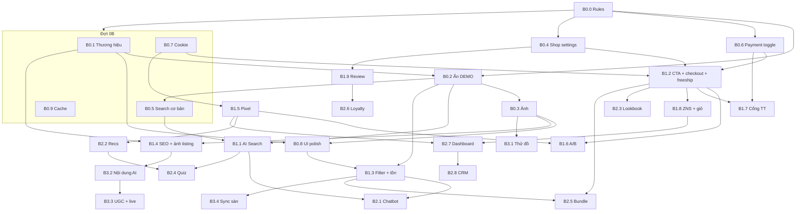

# Kế hoạch triển khai Cursor — PTT Shop (pttshop.vn)

Hệ thống: PTT Shop (https://pttshop.vn), storefront Next.js  
Phiên bản: v0.1 (bản nháp để thảo luận)  
Đi kèm: [Spec nâng cấp](spec-nang-cap-pttshop.md) (cùng thư mục). Mọi yêu cầu chức năng và tiêu chí nghiệm thu lấy từ spec; kế hoạch này chỉ chia việc cho Cursor / cloud agent.  
Giới hạn: **không có sẵn cây file repo.** Không đoán đường dẫn. Mỗi prompt bắt buộc agent khám phá repo trước khi sửa.

Cách dùng:

- Gắn `AGENTS.md` và rule ở mục 1 vào repo (batch B0.0), rồi mới chạy các batch sau.
- Mỗi batch = **một nhánh + một draft PR**. Agent **không merge** `main`, không bỏ draft, không deploy production.
- Thiếu giá trị nghiệp vụ (mục 2 và spec §9): dùng placeholder/config, **không bịa**, ghi rõ trong PR và dừng phần phụ thuộc giá trị đó.
- Prompt trong khối `text` copy nguyên sang Cursor (Agent / Cloud Agent).

---

## 1. Setup repo: AGENTS.md và `.cursor/rules`

Làm trước mọi batch tính năng, thành draft PR `chore/b0-0-agent-rules`.

### 1.1 File `AGENTS.md` (gốc repo) — dán và chỉnh nếu stack khác với thực tế

```text
# AGENTS.md — PTT Shop

## Trước khi sửa code
1. Khám phá repo: package.json, app/ hoặc src/, next.config, schema DB, thư mục component. Không giả định đường dẫn từ bộ nhớ hay từ audit.
2. Xác nhận stack (audit 25/11/2026 chỉ là giả định, phải đối chiếu): Next.js (có thể App Router, next/image, header RSC), Auth.js (cookie, /dang-nhap), tiếng Việt, nginx phía trước, route kiểu /san-pham, /gio-hang, /thanh-toan, /lien-he, media /media. DB, package manager (npm/pnpm/yarn/bun) và test runner: tự phát hiện.
3. Tóm tắt file sẽ đụng và kế hoạch nhỏ trước khi sửa diện rộng.

## Dữ liệu nghiệp vụ — không bịa
- Không bịa hotline, email, địa chỉ, giờ mở cửa, STK, ngưỡng freeship, số ngày đổi trả, giá, tồn kho, số đánh giá, nội dung chính sách, hay URL Zalo/mạng xã hội.
- Mọi giá trị đó lấy từ config/admin/env (ví dụ shop_settings hoặc NEXT_PUBLIC_SHOP_* / SHOP_*). Thiếu giá trị: để trống hoặc cờ disabled, không hard-code “cho có”. Liệt kê phần thiếu trong mô tả PR và dừng các bước phụ thuộc.
- Không seed đánh giá ảo, tồn ảo, hay sản phẩm demo lên storefront production.
- Thương hiệu trên production chỉ là PTT Shop. Gỡ WEARLY, VIZFAS, vizfas.vn. Email vizfas không được thay bằng một email bịa; dùng biến cấu hình.

## Git và PR
- Một batch = một nhánh (ví dụ feat/b0-1-branding) = một draft PR. Không gộp nhiều batch trừ khi kế hoạch cho phép.
- Không merge vào main. Không bỏ trạng thái draft. Không push --force lên nhánh shared. Không sửa production env.
- PR mô tả: mục tiêu, file đổi, cách test, screenshot desktop 1440 và mobile 390, giá trị còn thiếu, rủi ro.

## Chất lượng
- Giữ UI tiếng Việt; đừng đổi copy đã đúng.
- Chạy lint/test hiện có (phát hiện lệnh trong package.json). Thêm test khi đụng logic giá, tồn, thanh toán, tìm kiếm, chính sách.
- Chụp trang đã sửa: desktop 1440×900 và mobile 390×844.
- Không làm Lighthouse trang chủ / PDP thụt rõ so với mốc audit (Performance trang chủ ~97 desktop / ~98 mobile, PDP mobile ~95, Accessibility ~96). Trang mới không bắt buộc đạt đúng số đó, nhưng không được làm trang chủ/PDP tụt nặng.
- Không commit secret, .env thật, khóa cổng thanh toán, token Zalo/CRM/sàn.

## Phạm vi
- Chỉ làm đúng batch được giao. Không “tiện thể” làm GĐ sau.
- Không đổi pháp nhân/MST, không đổi nền tảng khỏi Next.js, không viết app native (spec §10).
```

### 1.2 Rule Cursor — `.cursor/rules/pttshop.mdc`

```text
---
description: Quy tắc triển khai PTT Shop — bắt buộc với mọi agent
alwaysApply: true
---

Bạn đang làm trên repo storefront PTT Shop (pttshop.vn).

- Bắt đầu bằng cách khám phá repo. Không giả định đường dẫn file.
- Không bịa dữ liệu nghiệp vụ. Dùng config/env; thiếu thì placeholder, ghi vào PR, dừng phần phụ thuộc.
- Không merge main. Một batch một draft PR.
- Test + screenshot 1440 và 390. Không làm regress Lighthouse nặng trên trang chủ/PDP.
- Không commit secret. Không đưa hàng [DEMO] hay review ảo ra storefront public.
- Đọc AGENTS.md nếu có. Bám spec nâng cấp và batch được giao; không làm vượt phạm vi.
```

---

## 2. Đầu vào chủ shop phải chốt

Số thứ tự trùng spec §9. Chưa chốt thì batch phụ thuộc chỉ được làm phần khung (config rỗng / tính năng tắt).

### 2.1 Cần trước hoặc ngay đầu GĐ0

Không chốt các mục này thì B0.2, B0.3, B0.4, B0.6, B0.8 sẽ bị chặn hoặc chỉ giao được phần khung.

| # | Nội dung | Batch bị chặn nếu thiếu |
| --- | --- | --- |
| 9.1 | Hotline, link/OA Zalo, email CSKH (và email tuyển dụng). URL Facebook/Instagram/TikTok nếu có — chưa có thì để trống, ẩn icon. | B0.4 (form/kênh); B0.1 chỉ cần placeholder email, không bịa |
| 9.2 | Một địa chỉ và một khung giờ (footer đang 73 Tạ Hiện, 8:00–22:00; `/lien-he` đang 123 Nguyễn Huệ, 9:00–21:00). Agent không được tự chọn. | B0.4 |
| 9.3 | Ngưỡng freeship và phí ship chuẩn (audit thấy badge Free Shipping, giỏ 30.000đ, mốc 500.000đ — đây là mâu thuẫn đã quan sát, không phải số chốt). | B0.4, sau đó B1.2 |
| 9.4 | Số ngày đổi trả (7 trong bản nháp chính sách hay 30 trên badge PDP) và: đã duyệt đăng chính sách hay vẫn để draft. | B0.4 |
| 9.5 | STK/chủ TK/ngân hàng cho chuyển khoản, **hoặc** xác nhận ẩn phương thức này. VietQR/MoMo/ZaloPay để GĐ1 (B1.7). | B0.6 |
| 9.6 | Ẩn toàn bộ SP `[DEMO]` trên production ngay, hay chỉ ẩn storefront và giữ dữ liệu/staging. | B0.2 |
| Ảnh GĐ0 | File ảnh thật cho SP đang bán bị ô xám / 500 (lưới trang chủ, ô danh mục “Nữ”, Áo Thun Nữ Basic, Áo Thun Oversize, và mọi SP published còn thiếu ảnh). | B0.3 |
| Copy PDP | Chất liệu/mô tả đúng cho SP sai copy (đã thấy Áo Thun Nam Basic ghi “chất nỉ”, “unisex”). Không để agent bịa chất liệu. | B0.8 |

B0.0 (rules), B0.1 (gỡ WEARLY/VIZFAS), B0.5 (search cơ bản), B0.7 (cookie), B0.9 (cache/HSTS) có thể khởi động **không đợi** hết bảng trên; email/địa chỉ trong B0.1 để placeholder nếu chưa có 9.1.

### 2.2 Cần trước các giai đoạn sau

| Khi | Câu hỏi (spec mục 9) | Batch |
| --- | --- | --- |
| GĐ1 đo lường | 9.12 ID GA4, Meta Pixel, TikTok Pixel, Clarity | B1.5 |
| GĐ1 thanh toán | 9.5 merchant VietQR/MoMo/ZaloPay (cổng nào làm) | B1.7 |
| GĐ1 ZNS / giỏ bỏ dở | 9.1 Zalo OA + template ZNS | B1.8 |
| GĐ1 review | 9.14 chỉ sau giao? duyệt tay hay auto-publish? | B1.9 |
| GĐ1 checkout | 9.17 bắt buộc tài khoản hay giữ mua với tư cách khách | B1.2 (mặc định: giữ hành vi hiện tại nếu chưa chốt) |
| GĐ2 chatbot / size | 9.15 bảng size thật; 9.1 Zalo handoff | B2.1 |
| GĐ2 loyalty | 9.13 tỷ lệ điểm, hạng, referral, trần đổi điểm | B2.6 |
| GĐ2 CRM | 9.11 module/API CRM, credential | B2.8 |
| GĐ2 bundle | 9.18 hết một món thì ẩn gói hay bán lẻ | B2.5 |
| GĐ3 thử đồ | 9.7 hạn mức/chi phí; 9.8 ComfyUI hay API; 9.9 TTL xóa ảnh | B3.1 |
| GĐ3 nội dung AI | 9.16 ai duyệt | B3.2 |
| GĐ3 đa kênh | 9.10 gian Shopee/TikTok Shop, livestream; 9.19 nguồn sự thật tồn | B3.3, B3.4 |

---

## 3. Lộ trình batch (tóm tắt)

31 batch (B0.0–B3.4), mỗi batch khoảng 1–3 ngày (S ngắn hơn, L có thể 3 ngày hoặc tách PR kỹ thuật nếu agent thấy quá lớn — phải hỏi trước khi tách).

| Batch | GĐ | Mục tiêu | Spec | Effort | Đợi |
| --- | --- | --- | --- | --- | --- |
| B0.0 | 0 | AGENTS.md + cursor rules | kế hoạch §1 | S | — |
| B0.1 | 0 | Gỡ WEARLY / VIZFAS, thống nhất PTT Shop | §5.1, §5.9 (chính tả) | S | B0.0 |
| B0.2 | 0 | Ẩn catalog `[DEMO]` khỏi storefront + sitemap | §5.2 | S | B0.0; 9.6 |
| B0.3 | 0 | Sửa ảnh vỡ/ô xám, bỏ Unsplash cho hàng đang bán | §5.3 | M | B0.2 (nên); ảnh chủ shop |
| B0.4 | 0 | Config duy nhất: liên hệ, badge, chính sách | §5.4, §5.5 | M | 9.1–9.4 |
| B0.5 | 0 | Tìm kiếm cơ bản → `/san-pham?q=` | §5.6 | S | B0.0; nên sau B0.2 |
| B0.6 | 0 | Ẩn chuyển khoản nếu chưa cấu hình / hiện khi có STK | §5.7 | S | 9.5 |
| B0.7 | 0 | Banner cookie không che CTA/giá/thanh toán | §5.8 | S | B0.0 |
| B0.8 | 0 | Copy PDP, lọc trùng, menu mobile, icon, contrast | §5.9 | S | B0.1, B0.3; copy chủ shop |
| B0.9 | 0 | Cache trang public, HSTS | §5.10 | S | B0.0 |
| B1.1 | 1 | AI Search (không dấu, typo, NLP, autosuggest) | §6.1 | L | B0.2, B0.5 |
| B1.2 | 1 | Mua ngay, sticky CTA, checkout một trang, thanh freeship | §6.2, §6.3 | M | B0.6, B0.7, B0.4 (ngưỡng) |
| B1.3 | 1 | Lọc giá/size/màu + tồn thật / scarcity | §6.4, §6.5 | M | B0.2, B0.8 |
| B1.4 | 1 | SEO kỹ thuật + tối ưu ảnh listing | §6.6, §6.7 | M | B0.1, B0.3 |
| B1.5 | 1 | GA4, Meta, TikTok Pixel, Clarity + consent | §6.8 | S | B0.7; 9.12 |
| B1.6 | 1 | Nền tảng A/B testing | §6.9 | M | B1.5 |
| B1.7 | 1 | VietQR, MoMo, ZaloPay (chỉ cổng đã chốt) | §6.10 | L | B0.6, B1.2; 9.5 |
| B1.8 | 1 | ZNS + giỏ hàng bỏ dở | §6.11, §6.12 | M | B1.2; 9.1 |
| B1.9 | 1 | Review ảnh/video chỉ từ đơn đã giao | §6.13 | M | B0.4; 9.14 |
| B2.1 | 2 | Chatbot AI grounded + handoff Zalo | §7.1 | L | GĐ1; 9.15, 9.1 |
| B2.2 | 2 | Gợi ý cá nhân hóa | §7.2 | M | B0.2, B1.5 |
| B2.3 | 2 | Lookbook / Shop the look | §7.3 | M | B0.2, B0.3, B1.2 |
| B2.4 | 2 | Style quiz | §7.4 | M | B1.1, B1.3, B2.2 |
| B2.5 | 2 | Combo / bundles | §7.5 | M | B1.2, B1.3; 9.18 |
| B2.6 | 2 | Điểm, hạng, giới thiệu | §7.6 | L | 9.13; đơn/trạng thái giao tin cậy |
| B2.7 | 2 | Dashboard doanh thu | §7.7 | M | B1.5, B1.8 |
| B2.8 | 2 | Đồng bộ PTT CRM (rs.pttads.vn) | §7.8 | L | 9.11 |
| B3.1 | 3 | AI thử đồ, consent, metering, xóa ảnh | §8.1 | L | 9.7–9.9; ảnh sạch |
| B3.2 | 3 | Nội dung AI có người duyệt | §8.2 | L | 9.16; B0.3, B1.4 |
| B3.3 | 3 | UGC TikTok/Reels + link live/sàn | §8.3, §8.4 | S | 9.10; quyền dùng video |
| B3.4 | 3 | Đồng bộ tồn Shopee / TikTok Shop | §8.5 | L | B1.3; 9.10, 9.19 |

---

## 4. Giai đoạn 0 — dọn lỗi (PR nhỏ, làm nhanh)

Quy tắc chung mọi prompt GĐ0: đọc `AGENTS.md`; khám phá repo trước; một draft PR; screenshot 1440 và 390; không merge main.

### B0.0 — Rule cho agent — effort S

**Mục tiêu.** Gắn `AGENTS.md` và `.cursor/rules/pttshop.mdc` (nội dung mục 1).  
**Spec.** Kế hoạch §1. **Phụ thuộc.** Không. **Đầu vào.** Không.

**Prompt**

```text
Bạn đang thêm quy tắc làm việc vào repo PTT Shop (pttshop.vn, Next.js).

1) Khám phá repo: đã có AGENTS.md, .cursor/rules, CONTRIBUTING chưa? Stack thực tế (package manager, App Router hay Pages) ra sao? Không giả định đường dẫn.

2) Thêm hoặc cập nhật:
- AGENTS.md ở gốc repo (nội dung do người giao cung cấp trong brief — nếu không đính kèm, tạo file theo đúng các mục: khám phá trước, không bịa dữ liệu nghiệp vụ, một draft PR, không merge main, test + screenshot 1440/390, không regress Lighthouse nặng, không commit secret).
- .cursor/rules/pttshop.mdc với alwaysApply: true, tóm tắt cùng quy tắc (cú pháp frontmatter theo document Cursor hiện có trong repo nếu đã có rule khác).

3) Không sửa storefront, không đổi copy, không commit .env.

Kết thúc: draft PR chore/b0-0-agent-rules, nêu file đã thêm.
```

**Checklist / kiểm tra.** File có trong PR; rule không làm gãy build.  
**Rủi ro.** Trùng với rule cũ — merge nội dung, đừng xóa rule khác.

---

### B0.1 — Thương hiệu PTT Shop — effort S

**Mục tiêu.** 0 chuỗi WEARLY, VIZFAS, vizfas.vn trên storefront; sửa “Nam · Nữmỗi ngày” và viết hoa “Đánh Giá”.  
**Spec.** §5.1, phần chính tả §5.9. **Phụ thuộc.** B0.0. **Đầu vào.** Email tuyển dụng (9.1): nếu chưa có, biến `SHOP_CAREERS_EMAIL` / config, không bịa.

**Prompt**

```text
Bạn triển khai batch B0.1 trên repo PTT Shop (Next.js), spec §5.1.

Bắt buộc trước khi sửa: khám phá repo, tìm mọi xuất hiện WEARLY, VIZFAS, vizfas, Wearly, Vizfas trong UI, metadata, chính sách, tuyển dụng, tin tức, đánh giá, CSS/watermark. Không giả định đường dẫn. Liệt kê file sẽ sửa.

Phạm vi:
- Thay thương hiệu hiển thị thành PTT Shop. Xóa watermark “WEARLY” trên lưới sản phẩm trang chủ.
- Trang Về chúng tôi, Tin tức, Đánh giá, Điều khoản, Tuyển dụng không còn VIZFAS.
- hello@vizfas.vn: thay bằng giá trị config/env. Nếu chưa có email thật, để placeholder rỗng và ẩn hoặc hiện “cập nhật sau” — KHÔNG bịa hello@pttshop.vn.
- Sửa “Nam · Nữmỗi ngày” (thiếu khoảng trắng) và thống nhất “Đánh Giá” với các mục nav khác.
- Không đụng catalog demo, ảnh, form liên hệ, chính sách pháp lý (batch khác).

Nghiệm thu: quét source + trang đã render = 0 kết quả WEARLY/VIZFAS/vizfas.vn. Screenshot desktop 1440 và mobile 390: trang chủ (khối từng có WEARLY), /ve-chung-toi, /tin-tuc, /danh-gia, tuyển dụng nếu có.

Chạy lint/test hiện có. Draft PR feat/b0-1-branding, không merge main. Ghi giá trị còn thiếu (email).
```

**Checklist.** 0 WEARLY/VIZFAS; about/news/reviews mang tên PTT Shop; typo đã sửa.  
**Kiểm tra.** `rg -i 'wearly|vizfas|vizfas\.vn'`; mở các URL trên; screenshot.  
**Rủi ro.** Chuỗi trong migration/seed/admin — ẩn trên storefront public là đủ ở batch này; đừng phá CMS.

---

### B0.2 — Ẩn sản phẩm `[DEMO]` — effort S

**Mục tiêu.** Storefront, sitemap, search, gợi ý không còn `[DEMO]` hay `/san-pham/demo-...`.  
**Spec.** §5.2. **Phụ thuộc.** B0.0; **9.6** (ẩn production ngay hay giữ staging). **Đầu vào.** 9.6. Nếu chưa chốt: làm cờ `is_demo`, mặc định ẩn trên production, không xóa cứng.

**Prompt**

```text
Bạn triển khai batch B0.2, spec §5.2 — ẩn sản phẩm demo khỏi storefront PTT Shop.

Khám phá repo trước: model sản phẩm, query listing/trang chủ/sitemap/search/related, chỗ tạo sitemap. Không giả định đường dẫn.

Phạm vi:
- Thêm (hoặc dùng) cờ is_demo hoặc quy ước slug/sku demo. Storefront, sitemap public, API public chỉ lấy is_demo=false và status published.
- Truy cập slug demo trên production: 404 hoặc redirect, không index.
- Admin/môi trường nội bộ vẫn xem được demo (bộ lọc hoặc NODE_ENV/staging).
- Không xóa cứng dữ liệu trừ khi chủ shop đã chốt 9.6 là xóa. Không đụng ảnh hay thương hiệu (B0.1/B0.3).

Nghiệm thu: /san-pham, trang chủ, sitemap public = 0 tiêu đề [DEMO], 0 URL /san-pham/demo-... . Draft PR feat/b0-2-hide-demo. Screenshot listing 1440 và 390. Không merge main.
```

**Checklist.** Sitemap sạch; slug demo không index.  
**Kiểm tra.** `/sitemap.xml`, `/san-pham`, mở một slug demo đã biết từ audit (ví dụ `/san-pham/demo-ao-thun-nam-cotton-basic`).  
**Rủi ro.** Sitemap cache; seed test phụ thuộc demo — cập nhật test.

---

### B0.3 — Ảnh sản phẩm — effort M

**Mục tiêu.** 0 ô xám / ảnh 4xx–5xx trên trang chủ và SP đang bán; không dùng Unsplash cho hàng đang bán.  
**Spec.** §5.3. **Phụ thuộc.** Nên sau B0.2. **Đầu vào.** File ảnh thật do chủ shop cung cấp. **Không** lấy ảnh stock tùy ý để “lấp chỗ”.

**Prompt**

```text
Bạn triển khai batch B0.3, spec §5.3 — ảnh sản phẩm PTT Shop.

Khám phá: next/image, next.config remotePatterns, component card/gallery/ô danh mục trang chủ, nguồn /media và Unsplash. Không giả định đường dẫn.

Đã quan sát (audit): lưới trang chủ và ô danh mục “Nữ” ô xám; /san-pham?category=ao-thun có 2 ảnh Unsplash qua /_next/image trả 500 (Áo Thun Nữ Basic, Áo Thun Oversize); thumbnail “ORIGINAL” trên PDP Áo Thun Nam Basic không khớp mẫu.

Phạm vi:
- Sửa nguồn ảnh cho hàng đang bán: host /media (hoặc CDN shop), đi /_next/image với sizes đúng.
- Ngừng phụ thuộc Unsplash (hoặc domain ngoài không kiểm soát) cho SP published. Gỡ remote pattern nếu không còn cần.
- Gallery PDP khớp đúng mẫu; bỏ ảnh không thuộc SP. Đổi màu: ưu tiên ảnh đúng màu nếu có.
- Nếu chủ shop CHƯA giao file ảnh: đừng bịa/tải Unsplash thay thế. Liệt kê SP còn thiếu ảnh trong PR, có thể hiện placeholder có alt rõ, và dừng phần “thay ảnh thật”.
- Không làm thử đồ AI (GĐ3). Không tối ưu nặng listing (B1.4) ngoài việc ảnh đi qua optimizer.

Nghiệm thu: trang chủ, /san-pham, PDP SP đang bán — 0 ô xám, 0 4xx/5xx ảnh. Screenshot 1440 và 390. Draft PR feat/b0-3-product-images, không merge main.
```

**Checklist.** Hết 500 `/_next/image` trên URL public đang bán; gallery nam basic không còn ảnh lạ nếu đã có ảnh đúng.  
**Kiểm tra.** DevTools Network trên trang chủ và `/san-pham?category=ao-thun`; xem PDP `/san-pham/ao-thun-nam-basic`.  
**Rủi ro.** Ảnh demo lẫn ảnh thật; `sizes` sai làm vỡ layout; quên xóa domain Unsplash trong config.

---

### B0.4 — Config duy nhất: liên hệ và chính sách — effort M

**Mục tiêu.** Một nguồn cấu hình cho địa chỉ, giờ, kênh CSKH, freeship, ngày đổi trả; form gửi được; badge khớp chính sách; không tự chọn giữa hai địa chỉ/giờ đã thấy trên site.  
**Spec.** §5.4, §5.5. **Phụ thuộc.** **9.1–9.4** (và 9.3 cho badge). **Đầu vào.** Bảng §2.1. Nếu thiếu: chỉ làm khung config, UI đọc config, không hard-code một phía.

**Prompt**

```text
Bạn triển khai batch B0.4, spec §5.4 và §5.5 — một config cho liên hệ, badge tin cậy và chính sách PTT Shop.

Khám phá: footer, /lien-he, form, badge PDP (Free Shipping, Đổi trả 30 ngày), trang /chinh-sach-*, /ho-tro/*, /huong-dan-chon-size, /danh-gia, chỗ render số review. Không giả định đường dẫn. Không tự chọn địa chỉ “đúng”.

Phạm vi:
- Tạo nguồn cấu hình duy nhất (shop_settings hoặc env/admin): địa chỉ, giờ, hotline, email, link Zalo, (tuỳ chọn) MXH, freeship_threshold_vnd, standard_shipping_fee_vnd, return_days, trạng thái chính sách (draft/published, effective_at).
- /lien-he, footer, chính sách, hướng dẫn size đọc cùng nguồn. Form liên hệ gửi thật (email hoặc ticket), bỏ chữ “demo — không gửi email thật”. Có thông báo thành công/thất bại. Chống spam cơ bản (honeypot/captcha nếu repo đã có hướng).
- Điểm và số đánh giá PDP chỉ từ review public đã duyệt; nếu 0 thì “Chưa có đánh giá”, KHÔNG hiện ★ 4.6 (86 đánh giá) hay số ảo.
- Badge freeship và số ngày đổi trả lấy từ config, dùng chung PDP, giỏ, checkout, trang chính sách.
- Chỉ gỡ dòng “Bản nháp… Chưa có hiệu lực” khi config nói đã publish. Nếu chưa duyệt: giữ draft, không hứa điều kiện trái bản nháp.
- Canonical một URL nếu /chinh-sach-doi-tra và /ho-tro/doi-tra (và cặp tương tự) trùng nội dung — redirect cái còn lại.
- Hiện hotline/Zalo khi có giá trị; ẩn khi rỗng. Không bịa số điện thoại, không dùng MST 0319378318 như hotline.

Nếu 9.1–9.4 chưa được cung cấp: implement config + gắn UI, để giá trị trống / draft, liệt kê thiếu trong PR, không điền 73 Tạ Hiện hay 123 Nguyễn Huệ như “đáp án”.

Nghiệm thu theo spec §5.4–5.5. Screenshot liên hệ, footer, PDP (badge + khối đánh giá), một trang chính sách — 1440 và 390. Draft PR feat/b0-4-shop-settings. Không merge main. Chạy lint/test.
```

**Checklist.** Một địa chỉ/giờ khi đã chốt; form thử gửi được; review 0 không hiện 86; badge = config.  
**Kiểm tra.** Gửi form tới hộp test; so badge PDP với giỏ và `/chinh-sach-doi-tra`; grep “123 Nguyễn Huệ” / “86 đánh giá” / “demo — không gửi”.  
**Rủi ro.** Hai cây URL chính sách lệch nội dung; SMTP/env thiếu — đừng giả là đã gửi.

---

### B0.5 — Tìm kiếm cơ bản — effort S

**Mục tiêu.** Enter và nút Tìm đưa tới `/san-pham?q=` với kết quả (không gồm demo).  
**Spec.** §5.6. **Phụ thuộc.** B0.0; nên sau B0.2. **Đầu vào.** Không. AI search để B1.1.

**Prompt**

```text
Bạn triển khai batch B0.5, spec §5.6 — tìm kiếm cơ bản PTT Shop.

Khám phá: ô tìm kiếm header (aria “Tìm kiếm”, input name=q), trang /san-pham, router. Không giả định đường dẫn. Audit: Enter và nút Tìm vẫn ở trang chủ, không ra kết quả.

Phạm vi:
- Submit (Enter và nút Tìm) điều hướng /san-pham?q=... (giữ filter khác nếu đã có trên URL).
- Listing đọc q, lọc theo tên (và slug/danh mục nếu đã có sẵn). Loại is_demo nếu cờ đã có.
- Không kết quả: thông báo rõ + gợi ý danh mục, không im lặng ở /.
- Không làm autosuggest, không dấu, typo, NLP (B1.1). Không đổi UI hàng loạt.

Nghiệm thu: gõ “áo thun” và “hoodie” từ trang chủ → URL /san-pham?q=... và có kết quả nếu catalog có. Query rác: trang rỗng có message. Screenshot 1440 và 390. Draft PR feat/b0-5-basic-search. Không merge main.
```

**Checklist.** Enter = nút Tìm; demo không ra nếu B0.2 đã merge.  
**Kiểm tra.** Thủ công hai từ khóa; query `xyzabc123`.  
**Rủi ro.** Overlay search đóng trước khi submit — bắt sự kiện đúng.

---

### B0.6 — Bật/ẩn chuyển khoản — effort S

**Mục tiêu.** Không còn cảnh báo “Tài khoản nhận tiền chưa được cấu hình” trên phương thức đang hiện.  
**Spec.** §5.7. **Phụ thuộc.** **9.5**. **Đầu vào.** STK hoặc lệnh ẩn.

**Prompt**

```text
Bạn triển khai batch B0.6, spec §5.7 — phương thức chuyển khoản PTT Shop.

Khám phá checkout /thanh-toan, cấu hình thanh toán, COD. Không giả định đường dẫn. Audit: có COD và chuyển khoản, hiện lỗi đỏ chưa cấu hình STK.

Phạm vi:
- Admin/env: STK, chủ TK, ngân hàng (và chỗ cho VietQR sau này). Chỉ hiện “Chuyển khoản” khi enabled và config đủ.
- Thiếu config: ẩn phương thức, không banner lỗi đỏ.
- COD: giữ nếu đang bật. Không triển khai MoMo/ZaloPay/VietQR (B1.7). Không bịa số tài khoản.

Nghiệm thu: production/staging không hiện câu “chưa được cấu hình” cho method đang hiện. Nếu 9.5 đã cung cấp: UI đủ thông tin nhận tiền. Screenshot checkout 1440 và 390, có hàng trong giỏ. Draft PR feat/b0-6-payment-toggle. Không merge main.
```

**Checklist.** Method chưa đủ config bị ẩn; COD vẫn đặt được.  
**Kiểm tra.** Checkout với giỏ có SP; thử hai nhánh config đủ / thiếu.  
**Rủi ro.** Hard-code STK trong client bundle — chỉ server/config.

---

### B0.7 — Banner cookie — effort S

**Mục tiêu.** Banner không che USP, giá, CTA, khối thanh toán; nhớ lựa chọn trong phiên.  
**Spec.** §5.8. **Phụ thuộc.** B0.0. **Đầu vào.** Không.

**Prompt**

```text
Bạn triển khai batch B0.7, spec §5.8 — banner cookie PTT Shop.

Khám phá component cookie consent, layout trang chủ, PDP, /thanh-toan. Không giả định đường dẫn. Audit: desktop che “Free ship > 500k”; mobile PDP che giá/CTA lần đầu; checkout đẩy khối chuyển khoản xuống dưới banner.

Phạm vi:
- Banner không position:fixed đè vùng CTA. Dùng khoảng trống cuối trang hoặc thanh thấp có safe-area.
- Checkout: mọi phương thức thanh toán nằm trong form, không tách dưới banner.
- Nhớ lựa chọn (cần thiết / tất cả) đúng hạn đã công bố, không hỏi lại mỗi trang trong phiên.
- Không gắn pixel (B1.5); giữ hành vi “cookie đo lường chỉ khi đồng ý” nếu đã có sẵn.

Nghiệm thu: screenshot trang chủ desktop (USP freeship), PDP mobile 390 (giá/CTA), checkout 1440 và 390 khi banner đang hiện. Draft PR feat/b0-7-cookie-banner. Không merge main.
```

**Checklist.** Freeship/USP đọc được; payment trong form.  
**Kiểm tra.** Cửa sổ ẩn danh 1440 và 390.  
**Rủi ro.** `100vh` + thanh iOS; conflict với sticky CTA (B1.2 sau này — chừa safe-area).

---

### B0.8 — Copy PDP và lỗi UI nhỏ — effort S

**Mục tiêu.** Copy đúng (do chủ shop cung cấp), chip Nam/Nữ không lặp, menu mobile một “Liên hệ”, contrast giá gạch, apple-touch-icon không 404.  
**Spec.** §5.9. **Phụ thuộc.** B0.1, B0.3. **Đầu vào.** Copy chất liệu/mô tả đúng. Không bịa “cotton” hay chất liệu khác.

**Prompt**

```text
Bạn triển khai batch B0.8, spec §5.9 — copy PDP và UI nhỏ PTT Shop.

Khám phá PDP, chip lọc /san-pham, menu mobile, icon, style giá gạch ngang. Không giả định đường dẫn.

Phạm vi:
- Áo Thun Nam Basic (và SP được cung cấp copy): bỏ “chất nỉ” / “unisex” nếu chủ shop xác nhận sai; thay bằng copy họ đưa. Chưa có copy: chỉ gỡ câu sai đã xác nhận hoặc để ghi chú trong PR, KHÔNG bịa mô tả mới.
- Gallery: đã xử lý ở B0.3; chỉ sửa nốt nếu còn ảnh không thuộc SP.
- Gỡ chip lọc Nam/Nữ trùng. Menu mobile: một mục Liên hệ; cân nhắc wishlist cho đồng bộ desktop nếu thiếu (không bắt buộc lớn).
- Contrast giá gạch ngang đạt WCAG AA với nền.
- /apple-touch-icon.png: trỏ tới /apple-icon.png hoặc phục vụ file đúng path (audit: apple-touch-icon.png 404, apple-icon.png 200).

Nghiệm thu theo §5.9. Screenshot listing, PDP, menu mobile 390, desktop 1440. Draft PR feat/b0-8-ui-polish. Không merge main.
```

**Checklist.** Một chip Nam, một Nữ; icon không 404; contrast ổn.  
**Kiểm tra.** `curl -sI` icon; Lighthouse a11y contrast trên PDP/listing.  
**Rủi ro.** Chip trùng do render hai nguồn filter — tìm đúng chỗ.

---

### B0.9 — Cache và HSTS — effort S

**Mục tiêu.** HTML public không `Cache-Control: no-store`; trang giỏ/tài khoản/checkout vẫn private; HSTS dài hơn 1 ngày khi đã chắc HTTPS.  
**Spec.** §5.10. **Phụ thuộc.** B0.0. **Đầu vào.** Không (hạ tầng nginx/Next — khám phá).

**Prompt**

```text
Bạn triển khai batch B0.9, spec §5.10 — cache và HSTS PTT Shop.

Khám phá: next.config, headers(), middleware, nginx/config deploy, chỗ set Cache-Control và Strict-Transport-Security. Không giả định đường dẫn. Audit: HTML public no-store; HSTS max-age=86400; Lighthouse bfcache fail vì no-store.

Phạm vi:
- Trang public (trang chủ, listing, PDP, chính sách): không no-store trên HTML. Dùng chiến lược phù hợp Next (ISR hoặc cache-control công khai). Giá/tồn thay đổi thường xuyên: cache ngắn hoặc lấy client-side, không cache cứng tồn lâu.
- /gio-hang, /thanh-toan, /tai-khoan (và API cá nhân): vẫn private, không cache công khai.
- HSTS max-age dài hơn 86400 theo thực hành triển khai; chỉ preload khi đã chắc toàn site HTTPS. Không phá môi trường local HTTP.
- Không đổi logic bán hàng.

Nghiệm thu: curl -sI trang chủ và /san-pham không còn no-store; trang giỏ/checkout/tài khoản không public-cache. Draft PR feat/b0-9-cache-headers. Ghi rõ header nginx vs Next. Không merge main.
```

**Checklist.** §5.10; bfcache không còn fail vì no-store trên trang chủ.  
**Kiểm tra.** `curl -sI https://staging-or-local/...` ; so header.  
**Rủi ro.** Header nginx ghi đè Next; cache nhầm giá/tồn; staging HTTP + HSTS preload — không bật preload nếu chưa chắc.

---

### Tiêu chí ra GĐ0

Đạt spec §5.11 trước khi bắt đầu GĐ1 (trừ phần chính sách/form/địa chỉ đang chờ chủ shop: phải có khung config và không còn dữ liệu mâu thuẫn bịa ra).

---

## 5. Giai đoạn 1 — chuyển đổi, đo lường, AI search

Chỉ khi GĐ0 đã qua review/staging (ít nhất B0.2, B0.5, B0.6, B0.7; B0.4 nếu đã có 9.3).

### B1.1 — AI Search — effort L

**Mục tiêu.** Không dấu, typo nhẹ, câu tự nhiên → filter, autosuggest, URL `/san-pham?q=` + filter.  
**Spec.** §6.1. **Phụ thuộc.** B0.2, B0.5. **Đầu vào.** Không bắt buộc.

**Prompt**

```text
Bạn triển khai batch B1.1, spec §6.1 — AI Search PTT Shop.

Khám phá: search B0.5, listing, schema product (tên, slug, mô tả, category, màu, size, giá, tags, is_demo). Không giả định đường dẫn. Có Postgres thì ưu tiên unaccent + full-text + pg_trgm; chưa có thì giải pháp tương đương đã có trong repo. Embedding/semantic là tùy chọn, không bắt buộc vendor trả phí.

Phạm vi:
- Chuẩn hóa query: thường, bỏ dấu, tách từ; fuzzy typo nhẹ.
- Parse câu khi chắc: loại, danh mục/giới tính, màu, size, khoảng giá, hàng mới, đang giảm. Không chắc thì dùng từ khóa, không bịa lọc.
- Autosuggest (debounce): tên SP, danh mục, câu gợi ý. Accessible (bàn phím, screen reader).
- Submit luôn /san-pham?q= kèm filter (color, size, priceMin, priceMax, category…) để share URL được.
- Không gồm demo/ẩn. Không kết quả: message + gợi ý gần nghĩa.
- Event nội bộ: query, filter đã parse, số kết quả, click (có thể hook B1.5 sau).
- Không làm chatbot (B2.1).

Nghiệm thu §6.1: “áo thun”, “ao thun”, “ao thun nam”; typo “hodie”; câu có giá/màu nếu data có. Screenshot ô gợi ý và trang kết quả 1440 + 390. Test đơn vị cho normalize/parse nếu phù hợp. Draft PR feat/b1-1-ai-search. Không merge main. Nếu PR quá lớn, đề xuất tách (index vs UI) trước khi tự tách.
```

**Checklist.** Demo không ra; URL share được; typo/không dấu đạt.  
**Kiểm tra.** Bộ câu trong §6.1; Lighthouse trang chủ không tụt nặng vì script suggest.  
**Rủi ro.** N+1 query; debounce/race; tiếng Việt bỏ dấu thiếu thư viện.

---

### B1.2 — Mua ngay, sticky CTA, checkout, thanh freeship — effort M

**Mục tiêu.** CTA dính mobile, Mua ngay, checkout một trang không vỡ, thanh tiến độ freeship đúng config.  
**Spec.** §6.2, §6.3. **Phụ thuộc.** B0.6, B0.7, B0.4 (ngưỡng 9.3). **Đầu vào.** 9.3; 9.17 (nếu chưa: giữ guest checkout như hiện tại).

**Prompt**

```text
Bạn triển khai batch B1.2, spec §6.2 và §6.3 — chuyển đổi checkout PTT Shop.

Khám phá PDP, cart, /thanh-toan, phí ship, cookie banner (B0.7). Không giả định đường dẫn.

Phạm vi:
- PDP: nút “Mua ngay” (thêm đúng variant, tới /thanh-toan) cạnh “Thêm vào giỏ”. Bắt chọn size/màu trước; thiếu thì focus + báo, không thêm nhầm.
- Mobile: thanh CTA dính đáy (giá, tóm tắt variant, Thêm giỏ / Mua ngay), không đè cookie (safe-area) và không đè nút Zalo nếu có.
- Checkout một trang: giao hàng, phương thức, tóm tắt, mã giảm, điều khoản, Đặt hàng. Payment nằm trong form. Validate SĐT VN. Giữ trường hiện có (tên, SĐT, email, địa chỉ, tỉnh, phường, ghi chú, hóa đơn công ty).
- Ảnh dòng giỏ/checkout: ưu tiên ảnh đúng màu đã chọn.
- Thanh freeship trên giỏ và checkout từ shop_settings: còn thiếu X, đạt thì phí 0. Không hard-code 500.000 hay 30.000. Chưa có 9.3: đọc config, ẩn thanh nếu ngưỡng trống, ghi PR.
- Không bắt login nếu hiện đang cho guest (9.17 chưa chốt). Không làm MoMo/VietQR (B1.7).

Nghiệm thu §6.2–6.3, gồm case tạm tính dưới/trên ngưỡng khi đã có config. Screenshot PDP mobile (sticky), checkout 1440 và 390. Draft PR feat/b1-2-checkout-cta. Không merge main.
```

**Checklist.** Sticky không đè banner; Mua ngay đúng variant; freeship khớp config.  
**Kiểm tra.** Flow thêm giỏ → checkout COD; đổi số lượng quanh ngưỡng freeship.  
**Rủi ro.** Layout cookie + sticky + Zalo; tồn thay đổi lúc đặt (B1.3 sẽ siết).

---

### B1.3 — Lọc giá/size/màu và tồn thật — effort M

**Mục tiêu.** Filter share được qua URL; “còn N” / sắp hết / hết hàng đúng tồn variant, không scarcity ảo.  
**Spec.** §6.4, §6.5. **Phụ thuộc.** B0.2, B0.8. **Đầu vào.** Không (ngưỡng “sắp hết” có default admin, nêu trong PR).

**Prompt**

```text
Bạn triển khai batch B1.3, spec §6.4 và §6.5 — lọc listing và tồn thật PTT Shop.

Khám phá /san-pham, chip lọc, variant stock trên PDP/cart/checkout. Không giả định đường dẫn.

Phạm vi:
- Lọc: khoảng giá, màu, size, tuỳ chọn đang giảm/hàng mới. Sort giữ hiện có. URL phản ánh filter. Mobile: sheet lọc. Kết hợp với q (B0.5/B1.1). Facet chỉ hiện option còn trong tập lọc. Trạng thái rỗng rõ.
- PDP: “Còn N (màu / size)” đúng tồn variant khi đổi lựa chọn. Ngưỡng low-stock cấu hình. Hết hàng: disable thêm giỏ/mua ngay, gợi ý variant khác nếu còn.
- Cart/checkout từ chối nếu tồn không đủ. CẤM countdown hay “chỉ còn 2” giả.

Nghiệm thu §6.4–6.5. Test tồn 0 và N dưới ngưỡng. Screenshot lọc 1440 + 390, PDP hết hàng. Draft PR feat/b1-3-filters-stock. Không merge main.
```

**Checklist.** URL reload đúng tập; không oversell trong test.  
**Kiểm tra.** Filter kết hợp + q; hai tab đặt cùng variant (nếu làm được test).  
**Rủi ro.** Race tồn; facet chậm.

---

### B1.4 — SEO kỹ thuật và ảnh listing — effort M

**Mục tiêu.** Title/description/canonical/OG/JSON-LD riêng từng loại trang; listing nhẹ hơn mốc ~2,2 MB.  
**Spec.** §6.6, §6.7. **Phụ thuộc.** B0.1, B0.3. **Đầu vào.** Không.

**Prompt**

```text
Bạn triển khai batch B1.4, spec §6.6 và §6.7 — SEO và ảnh listing PTT Shop.

Khám phá metadata, layout, PDP, listing, next/image. Không giả định đường dẫn. Audit: nhiều trang trùng title generic; không canonical/OG/JSON-LD; listing ~2,2 MB.

Phạm vi:
- Title/description riêng: listing (theo danh mục và q), PDP, giỏ, liên hệ, BST, tin, chính sách.
- canonical; OG + Twitter (title, description, image, url, type). PDP: ảnh SP, Product + Offer (VND, availability khớp tồn). Organization, WebSite + SearchAction tới /san-pham?q=, BreadcrumbList. FAQPage chỉ nếu FAQ tĩnh. Không review schema khi chưa có review thật.
- Ảnh card/listing/thumbnail qua /_next/image, sizes đúng, lazy dưới fold, ưu tiên LCP đầu. Giới hạn dung lượng upload admin nếu có chỗ upload.

Nghiệm thu §6.6–6.7. Đo lại transfer /san-pham. View-source PDP và listing (title, canonical, og, json-ld). Screenshot không bắt buộc đầy đủ mọi trang nhưng cần PDP + listing 1440. Draft PR feat/b1-4-seo-images. Không merge main. Lighthouse SEO/perf trang chủ và PDP không tụt nặng.
```

**Checklist.** Title listing ≠ trang chủ; Offer.availability đúng; ảnh listing giảm rõ.  
**Kiểm tra.** View-source; Lighthouse; Network transfer.  
**Rủi ro.** JSON-LD review ảo; OG image 404.

---

### B1.5 — Pixel và Clarity — effort S

**Mục tiêu.** GA4, Meta, TikTok, Clarity chỉ chạy khi đồng ý cookie đo lường; event mua đúng.  
**Spec.** §6.8. **Phụ thuộc.** B0.7; **9.12**. **Đầu vào.** Measurement IDs. Chưa có ID: khung config, không chèn ID giả.

**Prompt**

```text
Bạn triển khai batch B1.5, spec §6.8 — đo lường PTT Shop.

Khám phá cookie consent (B0.7), checkout, PDP. Không giả định đường dẫn.

Phạm vi:
- Config ID: GA4, Meta Pixel, TikTok Pixel, Microsoft Clarity. Script đo lường chỉ tải khi khách “Đồng ý tất cả”. “Chỉ cookie cần thiết”: không tải.
- Event tối thiểu: view_item, add_to_cart, begin_checkout, add_payment_info, purchase (id, giá trị, items), search, sign_up, generate_lead (form liên hệ). purchase chỉ khi tạo đơn thành công.
- Tài liệu ngắn mapping event trong PR hoặc /docs. Không hard-code ID. Không bịa ID mẫu trên production.

Nghiệm thu §6.8. Draft PR feat/b1-5-analytics. Không merge main.
```

**Checklist.** Hai nhánh consent; purchase đúng giá trị đơn test.  
**Kiểm tra.** Debug GA4/Meta/TikTok; Clarity session sau khi đồng ý.  
**Rủi ro.** Double-fire vì Strict Mode; ID lộ ở repo — chỉ env.

---

### B1.6 — A/B testing — effort M

**Mục tiêu.** Gán biến thể bền, gắn event, admin bật/tắt 1–2 test CTA/sticky.  
**Spec.** §6.9. **Phụ thuộc.** B1.5. **Đầu vào.** Không.

**Prompt**

```text
Bạn triển khai batch B1.6, spec §6.9 — A/B testing PTT Shop.

Khám phá PDP CTA, sticky (B1.2), analytics (B1.5). Không giả định đường dẫn. In-house hoặc công cụ đã có trong repo; không bắt buộc vendor trả phí.

Phạm vi: model experiment (key, variants, %, trang, thời gian, metric); assignment bền cookie/user; gửi experiment_id/variant kèm event. Admin bật/tắt test copy nút / hiện sticky mà không deploy lại app (nếu kiến trúc cho phép). GĐ1 chỉ cần chạy được 1–2 test. Tắt experiment → mọi khách về control.

Nghiệm thu §6.9. Draft PR feat/b1-6-ab-testing. Không merge main.
```

**Checklist.** Reload giữ biến thể; tắt về control.  
**Kiểm tra.** Hai trình duyệt/cookie khác nhau.  
**Rủi ro.** Flicker SSR; conflict cache trang (B0.9) với variant — không cache HTML khác nhau dưới cùng URL nếu chưa tách.

---

### B1.7 — VietQR, MoMo, ZaloPay — effort L

**Mục tiêu.** Chỉ hiện cổng đã chốt và đủ merchant config; webhook idempotent.  
**Spec.** §6.10. **Phụ thuộc.** B0.6, B1.2; **9.5**. **Đầu vào.** Merchant từng cổng. Chưa có: khung provider, `enabled=false`.

**Prompt**

```text
Bạn triển khai batch B1.7, spec §6.10 — cổng thanh toán PTT Shop.

Khám phá checkout, payment_methods (B0.6), webhook, đơn hàng. Không giả định đường dẫn.

Phạm vi:
- Mỗi cổng (VietQR, MoMo, ZaloPay) là module enabled riêng. Chưa chốt / thiếu merchant: không hiện.
- VietQR: QR đúng số tiền và nội dung đối soát; khớp webhook/polling; chống cộng tiền hai lần.
- MoMo/ZaloPay: tạo phiên, redirect/app, webhook ký, idempotent, timeout, hủy. Đơn chờ TT hết hạn theo config; UI trạng thái rõ.
- Không lưu số thẻ. Không log secret. Sandbox vs production qua env.
- Admin đối soát giao dịch tối thiểu (danh sách, trạng thái).

Nghiệm thu §6.10 trên sandbox từng cổng đã bật. Draft PR feat/b1-7-payment-gateways (tách PR theo cổng nếu quá lớn — hỏi trước). Không merge main. Không commit khóa thật.
```

**Checklist.** Webhook gọi 2 lần không nhân đơn; cổng tắt không hiện.  
**Kiểm tra.** Sandbox thành công / hủy / timeout.  
**Rủi ro.** Chữ ký webhook; đồng hồ hết hạn; lộ secret.

---

### B1.8 — ZNS và giỏ bỏ dở — effort M

**Mục tiêu.** ZNS theo mốc đơn; nhắc giỏ có rule, opt-out, không spam.  
**Spec.** §6.11, §6.12. **Phụ thuộc.** B1.2; **9.1** (OA/ZNS). **Đầu vào.** OA + template. Thiếu: khung log + job, kênh email nếu đã có, ZNS tắt.

**Prompt**

```text
Bạn triển khai batch B1.8, spec §6.11 và §6.12 — ZNS và giỏ bỏ dở PTT Shop.

Khám phá đơn hàng, trạng thái, cart, user/email/SĐT, job/queue. Không giả định đường dẫn.

Phạm vi:
- ZNS: template đã duyệt, biến tên, mã đơn, tổng, trạng thái, link /tra-cuu-don. Gửi khi đổi trạng thái (đặt thành công, đã TT, đang giao, đã giao, hủy) nếu có SĐT và template. Lỗi không chặn đổi trạng thái đơn. Tôn trọng opt-in marketing; ZNS giao dịch theo template. Admin xem log gửi/lỗi.
- Giỏ bỏ dở: gắn user hoặc cookie + email/SĐT đã điền. Thời điểm và số lần do admin. Không gửi nếu đã đặt/hủy hoặc hết tồn toàn dòng. Link khôi phục giỏ. Opt-out. Bảng đếm tối thiểu (số giỏ, số nhắc, số đơn lấy lại).

Nghiệm thu §6.11–6.12 với SĐT/email test. Draft PR feat/b1-8-zns-abandoned-cart. Không merge main. Không commit token Zalo.
```

**Checklist.** Đơn vẫn tạo khi ZNS lỗi; sau đặt hàng không còn nhắc giỏ.  
**Kiểm tra.** Job thủ công / cron test.  
**Rủi ro.** Spam; template chưa duyệt; PII trong log.

---

### B1.9 — Review ảnh/video thật — effort M

**Mục tiêu.** Chỉ khách đã nhận hàng; duyệt trước khi public; điểm PDP đúng.  
**Spec.** §6.13. **Phụ thuộc.** B0.4 (đã cấm số ảo); **9.14**. **Đầu vào.** 9.14 (mặc định: duyệt tay).

**Prompt**

```text
Bạn triển khai batch B1.9, spec §6.13 — đánh giá thật PTT Shop.

Khám phá PDP đánh giá, /danh-gia, model đơn/order_item, upload media. Không giả định đường dẫn.

Phạm vi:
- Chỉ mở form khi đơn delivered/hoàn tất và dòng hàng thuộc đơn; một review / SP / đơn.
- Ảnh/video: giới hạn dung lượng/định dạng. Mặc định ẩn đến khi admin duyệt (trừ khi 9.14 là auto-publish).
- PDP và /danh-gia: điểm và phân bổ chỉ từ review đã duyệt. Schema SEO chỉ khi có review thật. Cấm seed số ảo.
- UGC TikTok không tính vào sao (B3.3).

Nghiệm thu §6.13. Screenshot PDP 0 review và sau 1 review duyệt — 1440 + 390. Draft PR feat/b1-9-reviews. Không merge main.
```

**Checklist.** Chưa mua không gửi được; chưa duyệt không hiện, không cộng sao.  
**Kiểm tra.** Tài khoản chưa mua; luồng duyệt admin.  
**Rủi ro.** Upload lớn; nội dung không phù hợp — cần duyệt.

---

## 6. Giai đoạn 2 — tư vấn, cá nhân hóa, loyalty

Sau GĐ1 ổn định trên staging (search, checkout, tồn, pixel).

### B2.1 — Chatbot AI tư vấn — effort L

**Spec.** §7.1. **Phụ thuộc.** GĐ1; **9.15**, **9.1**. **Đầu vào.** Bảng size; Zalo handoff. Model LLM: config, không chốt vendor/giá.

**Prompt**

```text
Bạn triển khai batch B2.1, spec §7.1 — chatbot AI PTT Shop.

Khám phá catalog, tồn, chính sách published, bảng size, tra cứu đơn, layout (tránh đè sticky CTA). Không giả định đường dẫn.

Phạm vi:
- Widget web, có thể mở từ PDP với context productId.
- CHỈ trả lời có căn cứ: tool search_products, get_product, suggest_size (cao, nặng, fit, product_id so với bảng size), suggest_outfit (catalog đang bán, không demo/ẩn), lookup_order (mã + SĐT khớp mới trả), handoff_zalo (link OA hoặc ticket + tóm tắt).
- Không nguồn thì nói chưa chắc, mời Zalo/form — CẤM bịa giá/tồn/số đo/chính sách. Không hứa freeship/đổi trả khác config đã publish. Không dùng review ảo.
- Nếu chưa có bảng size: suggest_size phải từ chối đoán.
- Lưu hội thoại có TTL; khách xóa được. Rate limit. Không tiết lộ tool ẩn, không đổi giá qua prompt.
- LLM qua env/provider config, không commit API key.

Nghiệm thu §7.1 (câu có citation; tra đơn sai SĐT không lộ đơn khác; handoff). Screenshot widget 1440 + 390. Draft PR feat/b2-1-chatbot. Không merge main.
```

**Rủi ro.** Hallucination; PII trong log; chi phí API — meter và giới hạn.

### B2.2 — Gợi ý cá nhân hóa — effort M

**Spec.** §7.2. **Phụ thuộc.** B0.2, B1.5. **Đầu vào.** Không.

**Prompt**

```text
Bạn triển khai batch B2.2, spec §7.2 — gợi ý sản phẩm PTT Shop.

Khám phá PDP, giỏ, trang chủ, lịch sử xem/mua, cookie consent. Không giả định đường dẫn.

Phạm vi: gợi ý ở PDP, giỏ, khối trang chủ. Tín hiệu item-to-item, xem/mua, quiz (B2.4 sau có thể gắn). Fallback hàng mới/bán chạy thật. Chỉ published còn bán, không demo, không chính nó. Copy không quá lời. Không cá nhân hóa dài hạn nếu khách từ chối cookie đo lường — fallback, không vỡ trang. API GET /api/recommendations (hoặc tương đương trong kiến trúc repo) có placement. Có thể bảng product_relations cho merchandising tay (ưu tiên hơn model).

Nghiệm thu §7.2. Screenshot PDP/giỏ. Draft PR feat/b2-2-recommendations. Không merge main.
```

**Rủi ro.** Gợi ý hết hàng; leak lịch sử trên máy dùng chung.

### B2.3 — Lookbook / Shop the look — effort M

**Spec.** §7.3. **Phụ thuộc.** B0.2, B0.3, B1.2. **Đầu vào.** Ảnh/look do content (có thể tạo CMS rỗng).

**Prompt**

```text
Bạn triển khai batch B2.3, spec §7.3 — lookbook PTT Shop.

Khám phá /bo-suu-tap, CMS, cart. Không giả định đường dẫn. Audit: chỉ 1 Essentials Collection.

Phạm vi: CMS looks + look_items (product/variant, thứ tự, publish). Trang index + trang look (hotspot hoặc danh sách), giá/tồn hiện tại, thêm từng món hoặc món còn hàng. Look nháp không public. Một món hết: vẫn xem, món hết đánh dấu, không chặn cả look.

Nghiệm thu §7.3. Draft PR feat/b2-3-lookbook. Screenshot 1440 + 390. Không merge main.
```

**Rủi ro.** Ảnh look lệch SP đã đổi; tồn lúc thêm giỏ.

### B2.4 — Style quiz — effort M

**Spec.** §7.4. **Phụ thuộc.** B1.1, B1.3, B2.2. **Đầu vào.** Bộ câu có thể default, admin sửa.

**Prompt**

```text
Bạn triển khai batch B2.4, spec §7.4 — style quiz PTT Shop.

Khám phá gợi ý B2.2, search/filter. Không giả định đường dẫn.

Phạm vi: 4–7 câu cấu hình trong admin (map sang tag/filter). Không hỏi dữ liệu nhạy cảm thừa. Kết quả: lưới SP + CTA listing đã lọc. Có thể bỏ qua. Lưu profile khi đăng nhập. Không bịa tồn/giá. Không bắt buộc tài khoản trước khi làm quiz.

Nghiệm thu §7.4 với bộ câu test cố định. Draft PR feat/b2-4-style-quiz. Không merge main.
```

**Rủi ro.** Quiz “mồ côi” nếu chưa có look/gợi ý — vẫn ra listing lọc.

### B2.5 — Combo / bundles — effort M

**Spec.** §7.5. **Phụ thuộc.** B1.2, B1.3; **9.18**. **Đầu vào.** 9.18; giá gói do admin, không bịa.

**Prompt**

```text
Bạn triển khai batch B2.5, spec §7.5 — bundle PTT Shop.

Khám phá cart, tồn, freeship, PDP. Không giả định đường dẫn.

Phạm vi: admin tạo bundle (thành phần, giá hoặc % giảm, thời hạn, publish). PDP món thành phần hiện bundle liên quan. Thêm bundle: chọn size/màu từng món. Trừ tồn từng variant. Hết một món: đúng hành vi 9.18 (ẩn gói hoặc bán lẻ) — chưa chốt thì implement cả hai qua config và mặc định không oversell (ẩn gói). Freeship tính trên tổng sau giảm bundle.

Nghiệm thu §7.5. Draft PR feat/b2-5-bundles. Không merge main.
```

**Rủi ro.** Giá âm / làm tròn; tồn một phần.

### B2.6 — Loyalty — effort L

**Spec.** §7.6. **Phụ thuộc.** **9.13**; trạng thái giao tin cậy. **Đầu vào.** Tỷ lệ điểm, hạng, referral, trần. Chưa có: schema + admin rule rỗng, feature flag tắt.

**Prompt**

```text
Bạn triển khai batch B2.6, spec §7.6 — điểm, hạng, giới thiệu PTT Shop.

Khám phá tài khoản, đơn, checkout, hoàn/hủy. Không giả định đường dẫn. KHÔNG bịa tỷ lệ điểm.

Phạm vi: cấu hình admin (điểm/số tiền, đơn được tính — paid hay delivered, trừ khi hoàn/hủy, hạn dùng, trần đổi/đơn, hạng, thưởng referral). Trang tài khoản: số dư, lịch sử, hạng, mã giới thiệu. Checkout: ô dùng điểm nếu bật. Chống tự referral (cùng tài khoản/SĐT). Feature flag: tắt thì ẩn UI.

Nghiệm thu §7.6 trên rule test do chủ shop hoặc rule staging ghi trong PR (không dùng số bịa trên production). Draft PR feat/b2-6-loyalty. Không merge main.
```

**Rủi ro.** Double-credit; hoàn tiền vs điểm; gian lận referral.

### B2.7 — Dashboard doanh thu — effort M

**Spec.** §7.7. **Phụ thuộc.** B1.5, B1.8. **Đầu vào.** Không (định nghĩa “doanh thu” ghi trên UI, đề xuất paid/delivered trừ hủy — chủ shop xác nhận).

**Prompt**

```text
Bạn triển khai batch B2.7, spec §7.7 — dashboard doanh thu PTT Shop.

Khám phá orders, payments, admin auth. Không giả định đường dẫn.

Phạm vi: màn admin lọc ngày, trạng thái, kênh (web; sàn để GĐ3). Số: doanh thu, số đơn, AOV, conversion nếu có pixel/session — thiếu đo lường thì ẩn hoặc ghi “chưa gắn”. Top SP, phương thức TT, giỏ bỏ dở (nếu B1.8 có dữ liệu), điểm/referral nếu B2.6 bật. Định nghĩa doanh thu hiện trên UI. Xuất CSV. Chỉ Admin. Đối chiếu số với query.

Nghiệm thu §7.7 với bộ đơn mẫu (số khớp SQL). 403 user không quyền. Draft PR feat/b2-7-revenue-dashboard. Không merge main.
```

**Rủi ro.** Lộ dữ liệu nếu thiếu ACL; timezone Asia/Saigon.

### B2.8 — Tích hợp PTT CRM — effort L

**Spec.** §7.8. **Phụ thuộc.** **9.11**. **Đầu vào.** API CRM, credential. Chưa có: outbox + payload, adapter giả lập, không gọi production CRM.

**Prompt**

```text
Bạn triển khai batch B2.8, spec §7.8 — đồng bộ PTT CRM (https://rs.pttads.vn).

Khám phá tạo khách, đổi trạng thái đơn, hàng đợi. Không giả định đường dẫn. Không giả định CRM đã có module e-commerce.

Phạm vi: shop → CRM khi tạo/cập nhật khách và đơn (tạo, paid, shipped, delivered, cancelled, refunded). Idempotent theo shop_order_id. Outbox + retry + cảnh báo; KHÔNG làm fail checkout khi CRM lỗi. Minimize PII theo contract đã chốt. Log kỹ thuật. Chiều ngược chỉ khi 9.11 yêu cầu (mặc định không). Credential server-side, không lộ client.

Nếu 9.11 chưa có endpoint: implement outbox, schema payload, adapter mock, ghi PR những field cần CRM xác nhận.

Nghiệm thu §7.8 trên staging/mock. Draft PR feat/b2-8-crm-sync. Không merge main. Không commit secret.
```

**Rủi ro.** Loop đồng bộ; GDPR/PII; timeout CRM.

---

## 7. Giai đoạn 3 — thử đồ, nội dung AI, đa kênh

### B3.1 — AI thử đồ — effort L

**Spec.** §8.1. **Phụ thuộc.** **9.7–9.9**; ảnh sạch (B0.3+). **Đầu vào.** Hạn mức, provider, TTL xóa. Mặc định: không train trên ảnh khách; feature tắt đến khi đủ ảnh + consent copy.

**Prompt**

```text
Bạn triển khai batch B3.1, spec §8.1 — virtual try-on PTT Shop.

Khám phá PDP, storage, auth, job/queue. Không giả định đường dẫn.

Phạm vi:
- Chỉ bật SP có ảnh sạch (checklist admin). Thiếu ảnh: ẩn nút.
- Consent bắt buộc trước upload (mục đích, TTL, có rời máy chủ nếu API thứ ba). Không tích = không lưu file.
- Metering theo 9.7 (config). Hết lượt: không render lén.
- Provider hoán đổi config: (A) ComfyUI tự host (B) API thứ ba — không hard-code một vendor, không ghi giá vendor. Copy consent đổi theo việc ảnh có rời máy chủ hay không.
- Ảnh gốc/kết quả/metadata: TTL 9.9, job xóa, DELETE của khách và admin, log kiểm toán, URL hết hạn 404. Mặc định cấm train trên ảnh khách.
- Disclaimer kết quả + CTA đúng variant. Rate limit / captcha hoặc login để chống lạm dụng.
- Chưa chốt 9.7–9.9: làm khung (job, consent, storage, flag tắt), không bật production.

Nghiệm thu §8.1 trên staging. Draft PR feat/b3-1-virtual-try-on. Không merge main. Không commit khóa GPU/API.
```

**Rủi ro.** Chi phí GPU; ảnh nhạy cảm; quên job xóa; GDPR.

### B3.2 — Nội dung AI có người duyệt — effort L

**Spec.** §8.2. **Phụ thuộc.** **9.16**; B0.3, B1.4. **Đầu vào.** Người duyệt.

**Prompt**

```text
Bạn triển khai batch B3.2, spec §8.2 — nội dung AI có duyệt, PTT Shop.

Khám phá admin CMS, PDP copy, /tin-tuc, upload ảnh. Không giả định đường dẫn.

Phạm vi: job tạo nháp ảnh model ảo, mô tả SP + meta, bài SEO, (tuỳ) video ngắn từ catalog/thuộc tính THẬT. Mọi artifact: draft/rejected/published, reviewed_by, reviewed_at. Production và sitemap/OG chỉ published. Cấm bịa chất liệu không có trong thuộc tính. Publish chỉ khi có reviewed_by. Cảnh báo “ảnh dựng AI” nếu nghiệp vụ yêu cầu (config copy). Không tự đăng MXH. API key qua env.

Nghiệm thu §8.2: nháp không lộ public; bộ test mô tả không thêm chất liệu lạ. Draft PR feat/b3-2-ai-content. Không merge main.
```

**Rủi ro.** Lộ nháp qua sitemap; copy sai như “chất nỉ” tái diễn nếu không chặn.

### B3.3 — UGC và link livestream / sàn — effort S

**Spec.** §8.3, §8.4. **Phụ thuộc.** **9.10**; quyền video. **Đầu vào.** URL embed, URL gian, lịch live. Chưa có gian: ẩn CTA.

**Prompt**

```text
Bạn triển khai batch B3.3, spec §8.3 và §8.4 — UGC và link live/sàn PTT Shop.

Khám phá PDP, header/footer/trang chủ, hiệu năng ảnh (B1.4). Không giả định đường dẫn.

Phạm vi:
- Admin nhúng URL TikTok/Reels đã có quyền, gắn SP, publish/gỡ. Embed theo nền tảng, mute mặc định, lazy-load, không phá LCP trang chủ. Không tính vào sao review. Fallback nếu embed lỗi.
- Config URL gian / livestream, nhãn, lịch hoặc nút “Đang live” bằng tay. Không giả live. Chưa có 9.10: ẩn khối, không nút chết.

Nghiệm thu §8.3–8.4. Screenshot. Draft PR feat/b3-3-ugc-livestream. Không merge main.
```

**Rủi ro.** Vi phạm bản quyền UGC; script TikTok làm chậm trang.

### B3.4 — Đồng bộ tồn sàn — effort L

**Spec.** §8.5. **Phụ thuộc.** B1.3; **9.10**, **9.19**. **Đầu vào.** Shop ID, token, nguồn sự thật tồn. Chưa có gian: adapter + mapping, flag tắt.

**Prompt**

```text
Bạn triển khai batch B3.4, spec §8.5 — đồng bộ tồn Shopee / TikTok Shop cho PTT Shop.

Khám phá variant stock, đơn, dashboard (B2.7 nếu có), job. Không giả định đường dẫn. Không giả định đã có gian hay token.

Phạm vi: mapping SKU shop ↔ sàn (SKU chưa map: cảnh báo, không đoán). Đồng bộ tồn theo 9.19 (sổ tổng hoặc buffer kênh) — chưa chốt thì config, mặc định không oversell. Job + webhook nếu sàn có. Đơn sàn trong phạm vi đã chốt: trừ cùng sổ, hiện kênh trên dashboard. API sàn chết: fail-safe đã ghi (buffer/khóa variant), web không sập, có alert. Token server-side.

Chưa có 9.10/9.19: khung channel_listings + job mock + báo cáo chưa map, flag tắt production.

Nghiệm thu §8.5 trên staging. Draft PR feat/b3-4-inventory-sync. Không merge main. Không commit token sàn.
```

**Rủi ro.** Oversell đa kênh; mapping sai; rate limit API sàn.

---

## 8. Chạy song song, sơ đồ và quy trình review

### 8.1 Bản đồ song song (cloud agent)

Nguyên tắc: hai agent không cùng sửa một vùng (layout/header/footer, checkout, product card, next.config) trong cùng thời điểm. Ưu tiên **đợt**, không mở cả 31 agent một lúc.

| Đợt | Batch chạy song song | Điều kiện | Vùng cần tránh trùng |
| --- | --- | --- | --- |
| 0A | B0.0 | Đầu tiên, PR nhỏ, nên merge rules trước | — |
| 0B | B0.1, B0.5, B0.7, B0.9 | Sau B0.0 | B0.1 đụng nhiều copy — nếu conflict với 0.5/0.7 (header), làm 0.1 trước rồi mới song song phần còn lại |
| 0C | B0.2, B0.6 | 9.6 và 9.5; 0.2 nên trước 0.3 | 0.2: query catalog/sitemap; 0.6: chỉ checkout thanh toán |
| 0D | B0.3, B0.4 | Ảnh; 9.1–9.4 | 0.3: media/card/gallery; 0.4: settings, footer, form, badge, chính sách |
| 0E | B0.8 | Sau 0.1 và 0.3 | PDP, filter chips, menu |
| 1A | B1.1, B1.4, B1.5 | GĐ0 đủ; 1.5 cần 9.12 và B0.7 | 1.1 search; 1.4 metadata/ảnh; 1.5 script consent |
| 1B | B1.2, B1.3 | 1.2 sau 0.6/0.7/0.4; 1.3 sau 0.8 | 1.2 PDP CTA + checkout; 1.3 filter + stock (tránh cùng file PDP — nếu trùng, nối tiếp) |
| 1C | B1.6 | Sau 1.5 (và 1.2 nếu test sticky) | — |
| 1D | B1.7, B1.9 | 1.7 sau 1.2; 1.9 sau 0.4 | 1.7 payments; 1.9 reviews |
| 1E | B1.8 | Sau 1.2; 9.1 | đơn, job |
| 2A | B2.2, B2.3, B2.7 | GĐ1 ổn | recs / lookbook / admin dashboard |
| 2B | B2.1, B2.5, B2.6 | 2.1 cần size+Zalo; 2.6 cần 9.13 | widget / cart bundle / loyalty |
| 2C | B2.4 | Sau 2.2, 1.1, 1.3 | — |
| 2D | B2.8 | 9.11 | outbox, không đụng UI khách nhiều |
| 3A | B3.2, B3.3 | 9.16; 9.10/quyền UGC | CMS / embed |
| 3B | B3.1, B3.4 | 9.7–9.9 và 9.10/9.19 | try-on jobs vs sync tồn — ít đụng nhau |



### 8.2 Quy trình review / QA

1. **Agent** hoàn thành batch trên nhánh `feat/b…` hoặc `chore/b…`, mở **draft PR**, điền: mục tiêu, file, checklist, lệnh test, screenshot 1440/390, giá trị §9 còn thiếu, rủi ro. Không merge, không “Ready for review” trừ khi chủ shop/lead yêu cầu.
2. **Chủ shop hoặc lead** review diff + screenshot. Thiếu dữ liệu nghiệp vụ thì bổ sung config/staging, không yêu cầu agent bịa.
3. **Deploy staging** (hoặc preview PR). Test tay các URL trong mục “Kiểm tra” của batch. Soát Lighthouse trang chủ/PDP nếu đụng hiệu năng, layout, script.
4. **Sửa theo review** trên cùng nhánh (commit bổ sung).
5. **Merge vào main** chỉ do người có quyền, sau khi staging ổn. Agent không tự merge, không deploy production, không sửa env production.
6. Conflict: rebase/merge main vào nhánh batch; không force-push nhánh người khác đang dùng.
7. GĐ sau chỉ mở khi các batch cổng của GĐ trước đã merge và đã kiểm trên staging (cột “Đợi” ở mục 3).

---

## 9. Prompt tổng (kickoff)

Dùng khi giao một agent “điều phối” hoặc để bắt đầu repo trống quy tắc. **Không** hiểu là “làm hết GĐ0–GĐ3 trong một PR”.

```text
Bạn là agent triển khai trên repo Next.js PTT Shop (https://pttshop.vn).

Tài liệu: spec nâng cấp và kế hoạch Cursor (kèm theo hoặc trong repo docs). Audit 25/11/2026 chỉ là hiện trạng đã quan sát, không phải cây file.

Việc làm theo thứ tự:
1) Khám phá toàn bộ repo (stack, script test, CI, cách mở PR). Không giả định đường dẫn.
2) Nếu chưa có AGENTS.md và .cursor/rules/pttshop.mdc, làm batch B0.0 trước, mở draft PR chore/b0-0-agent-rules, rồi DỪNG để người review. Không nhảy sang tính năng trong cùng PR.
3) Sau khi rules đã vào nhánh làm việc (hoặc đã được merge), bắt đầu đúng một batch được giao tiếp theo (mặc định B0.1 nếu không chỉ định). Một nhánh, một draft PR, không merge main, không deploy production.
4) Không bịa dữ liệu nghiệp vụ (hotline, địa chỉ, giờ, STK, freeship, ngày đổi trả, email, số review, tồn). Dùng config/env. Thiếu thì placeholder, liệt kê trong PR, dừng phần phụ thuộc.
5) Test lệnh có trong package.json. Screenshot desktop 1440 và mobile 390 cho trang đụng tới. Không làm Lighthouse trang chủ/PDP thụt nặng so với mốc audit (perf trang chủ ~97/98, PDP mobile ~95, a11y ~96).
6) Không commit secret. Không đưa [DEMO] hay review ảo ra storefront public. Không làm vượt phạm vi batch.

Báo cáo cuối: PR link, file đổi, cách test, checklist đạt/chưa, danh sách mục §9 còn thiếu.
```

Khi mở **cloud agent cho một batch**, dán prompt của batch đó (mục 4–7) và đính kèm `AGENTS.md` + đoạn spec liên quan; không dán cả 31 batch vào một agent.
